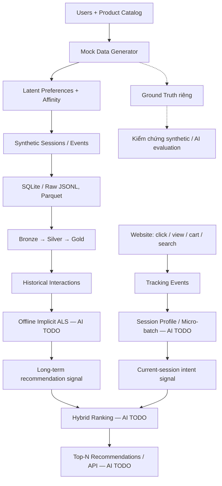

# NUTEE — Mock Data & Recommendation Data Pipeline

NUTEE là dự án website thương mại điện tử. Repository này có **website demo (React), backend (FastAPI/SQLite), Mock Data Generator và pipeline Bronze → Silver → Gold** để tạo và chuẩn bị dữ liệu cho hệ thống gợi ý sản phẩm.

> **Trạng thái:** Nhóm Data đã sinh, kiểm tra và đóng gói dataset synthetic. **ALS, xử lý ý định theo phiên, Hybrid Ranking và API recommendation vẫn là nhiệm vụ của nhóm AI**; Affinity trong simulator chỉ dùng để *sinh hành vi giả lập*, không phải mô hình recommendation đã huấn luyện.

## 1. Ý tưởng hệ thống



**Cách hoạt động mong muốn:** ALS học mối quan hệ user–product từ **lịch sử** (offline). Khi người dùng thao tác trên website, các tương tác mới được tổng hợp theo **session** để nhận biết nhu cầu hiện tại. **Hybrid Ranking** kết hợp kết quả ALS với tín hiệu session và metadata sản phẩm để sắp xếp Top-N. **Không cần train lại ALS sau từng click**; việc cập nhật nhanh nằm ở Session Profile/Ranking. Phần online này **chưa được triển khai**.

## 2. Phần Data đã xây dựng

| Thành phần | Chức năng |
| --- | --- |
| `data_generator/generate_users.py`, `generate_products.py`, `seed.py` | Sinh user và catalog sản phẩm (category, brand, price, specifications). |
| `data_generator/preferences.py`, `affinity.py` | Tạo sở thích giả lập theo category, brand, budget, kỹ thuật; tính điểm phù hợp để điều khiển mô phỏng. |
| `data_generator/simulate_sessions.py` | Sinh impression → click → view → wishlist/cart → purchase theo xác suất, position bias và ngân sách. |
| `data_generator/ground_truth.py` | Lưu long-term/shifted/effective session profiles **ngoài** behavioral events. |
| `pipeline/` | Ingest và xử lý Bronze (raw) → Silver (clean) → Gold (counts, session sequences). |
| `tests/` | Kiểm schema, timestamp, reference, event sequence, hashes, Ground Truth, profiling, connectivity. |
| `frontend/`, `backend/` | Website demo, catalog, tracking và checkout demo; chưa phục vụ kết quả từ AI recommendation. |

Ba chế độ mô phỏng:

- **S1 — Long-term:** Sở thích dài hạn tương đối ổn định; có thể có temporary session intent.
- **S2 — Intent Shift:** Sở thích chuyển sang category khác sau khoảng 65% timeline.
- **S3 — Cold-start:** Một nhóm user và product chỉ bắt đầu phát sinh/được hiển thị sau khoảng 70% timeline.

Mọi dữ liệu nêu dưới đây đều là **synthetic**, không đại diện cho khách hàng thật.

## 3. Dataset đã bàn giao — S1 Baseline v1

**Dataset ID:** `S1_long_term-28-0dc56c9b53df` · **Seed:** `28` · **Session intent probability:** `0.15`

| Chỉ số | Kết quả |
| --- | ---: |
| Catalog users / active users | 3.000 / 3.000 |
| Products | 300 |
| Events / sessions | 200.000 / 16.154 |
| Unique action user–item pairs | 26.882 |
| Trung vị sản phẩm có action/user | 9 |
| Interaction sparsity | 97,01% |
| Largest connected component | 100% **trên các nút có action** |
| Products không có action | 39 |
| Data Quality | **PASS — 200.000 schema hợp lệ, 0 lỗi** |

Đây là dataset **đủ để nhóm AI bắt đầu thử nghiệm Implicit ALS baseline**, nhưng chưa có kết quả chất lượng recommendation. Không suy ra hiệu quả mô hình trên người dùng thật từ các con số này.

**Gói bàn giao local:** `data/handoff/S1_long_term-28-0dc56c9b53df/` (thư mục `data/` có thể bị Git ignore; người clone cần nhận gói từ nhóm Data).

```text
S1_long_term-28-0dc56c9b53df/
├── data/
│   ├── users.json, products.json
│   ├── events.jsonl, events.parquet
├── ground_truth/
│   ├── user_profiles.json, session_profiles.json, manifest.json
├── reports/
│   ├── data_quality_report.json, connectivity_report.json
├── source_manifest.json
├── handoff_manifest.json
└── README.md
```

**Lưu ý:** `events` chứa sự kiện hành vi; `ground_truth` chứa sở thích ẩn *do simulator tạo ra*. Không trộn Ground Truth vào feature training nếu mục tiêu là học sở thích từ tương tác. 39 sản phẩm không có action không cung cấp lịch sử cho ALS thuần túy.

## 4. Cài đặt và chạy nhanh

Tại thư mục gốc repository (PowerShell):

```powershell
python -m venv .venv
.\.venv\Scripts\python.exe -m pip install -r backend/requirements.txt

# Kiểm tra lệnh seed và số users/products thực tế sau khi chạy.
.\.venv\Scripts\python.exe -m data_generator.seed --users 3000 --products 300 --seed 28
.\.venv\Scripts\python.exe -m data_generator.simulate_sessions --events 200000 --seed 28 --scenario S1_long_term
```

Simulator lấy users/products **từ SQLite đã seed**; thay mặc định trong `generate_users.py` không bảo đảm DB cũ tự tăng users. Kiểm tra bằng:

```powershell
python -c "from backend.db import records; print('Users:',len(records('users'))); print('Products:',len(records('products')))"
```

Chạy pipeline local cho dữ liệu synthetic (chọn `--as-of` sau timeline đã sinh):

```powershell
python -m pipeline.run_pipeline --source local --origin synthetic --as-of 2026-02-16T00:00:00+00:00
```

Chạy validator trên **dataset đã sinh**, không phải toàn bộ SQLite tích lũy từ nhiều lần chạy:

```powershell
python -m tests.validate_mock_dataset --dataset-dir "data/product-demo-v1/synthetic/raw/S1_long_term-28-0dc56c9b53df"
python -m tests.analyze_user_item_connectivity --dataset-dir "data/product-demo-v1/synthetic/raw/S1_long_term-28-0dc56c9b53df"
```

Kiểm tra cấu hình tại `configs/simulator.json`, schema tại `backend/schemas.py` và `docs/event-schema.md`. Để dùng dataset chuẩn đã kiểm tra, **không cần sinh lại**: đọc trực tiếp gói `data/handoff/...`.

## 5. Nhóm AI đọc gì trước?

| Dữ liệu | Mục đích |
| --- | --- |
| `data/events.parquet` | Lịch sử hành vi để xây dựng implicit interactions; có `distinct_id`, `product_id`, `session_id`, `event_name`, `timestamp`. |
| `data/products.json` | Metadata cho content-based, cold-item fallback và lọc catalog. |
| `data/users.json` | Danh sách users/ID mapping. |
| `ground_truth/*.json` | Hiểu profile giả lập và kiểm chứng riêng; **không dùng làm feature ALS mặc định**. |
| `reports/*.json` | Data Quality, sparsity, coverage, connectivity. |
| `source_manifest.json`, `handoff_manifest.json` | Xác định phiên bản và đối chiếu SHA-256. |
| Gold `user_item_event_counts`, `session_sequences` | Bảng đếm và chuỗi phiên sau ETL; cần dựng lại từ **train-only** khi đánh giá theo thời gian. |

Ví dụ đọc dữ liệu bàn giao (chạy từ root repo):

```python
import json
from pathlib import Path
import pandas as pd

root = Path('data/handoff/S1_long_term-28-0dc56c9b53df')
events = pd.read_parquet(root / 'data/events.parquet')
products = json.loads((root / 'data/products.json').read_text(encoding='utf-8'))
print(events['event_name'].value_counts())
print('users:', events['distinct_id'].nunique(), 'items:', events['product_id'].nunique())
```

`product_impression` là cơ hội được hiển thị, **không mặc nhiên là positive feedback**. Trong simulator, `product_view` luôn theo sau click nên việc cộng cả click và view có thể đếm hai lần cùng tín hiệu. Với đánh giá offline, **chia dữ liệu theo thời gian trước khi tính user–item aggregates**, tránh leakage.

## 6. Nhiệm vụ nhóm AI (chưa triển khai)

| Ưu tiên | Task | Đầu ra cần bàn giao |
| --- | --- | --- |
| **P0** | **AI-01 — Data intake:** đọc dataset, schema, kiểm coverage và ID mapping | Script/notebook kiểm dữ liệu, danh sách vấn đề và quy tắc xử lý |
| **P0** | **AI-02 — Implicit feedback + temporal split:** chọn event weights/confidence, tạo train/val/test | Ma trận user–item train-only và split tái lập được |
| **P0** | **AI-03 — Offline ALS baseline:** train ALS trên lịch sử; popularity baseline để đối chiếu | Model artifacts, mapping, Top-N thử nghiệm |
| **P0** | **AI-04 — Evaluation:** Recall@K, NDCG@K, coverage, unseen-user/item handling; kiểm leakage | Báo cáo baseline, phương pháp và giới hạn |
| **P1** | **AI-05 — Session Profile:** gom sự kiện mới theo `session_id`, micro-batch, nhận biết category/brand/spec/budget đang quan tâm | Session state và các tín hiệu cập nhật theo phiên |
| **P1** | **AI-06 — Hybrid Ranking:** kết hợp ALS + Session Intent + product metadata, fallback cold-start | Top-N ranker và kiểm thử S1/S2/S3 |
| **P1** | **AI-07 — Serving/Integration:** API đề xuất sản phẩm, fallback khi thiếu model, phối hợp backend/frontend | API contract và tích hợp website demo |

**Ranh giới trách nhiệm:** Nhóm Data phụ trách generator, pipeline, Ground Truth, validation, profiling, packaging. Nhóm AI phụ trách xây tương tác, huấn luyện, đánh giá, Session Profile, Hybrid Ranking và inference. ALS **không tự học realtime sau mỗi click**; tín hiệu theo phiên được cập nhật ở Session Profile/Hybrid Ranking, ALS retrain định kỳ theo dữ liệu mới.

## 7. Giới hạn cần biết

- Hành vi được sinh bằng quy tắc/xác suất; Data Quality PASS **không** chứng minh dữ liệu giống hành vi người thật.
- S1 sử dụng exposure sampling có thiên lệch; item chưa hiển thị không được xem là người dùng không thích.
- 39 sản phẩm không có action; ALS thuần không học được item factors có ý nghĩa cho chúng nếu không có tương tác train.
- S2/S3 đã có simulator và bài kiểm tra kịch bản; gói **đang bàn giao** ở đây là **S1**, không phải dataset S2/S3.
- Các event `purchase` của simulator là sự kiện giả lập, không nhất thiết tạo order trong DB hoặc trừ kho.
- `data/` và `runtime/` có thể không đi theo Git clone; gói bàn giao phải được chuyển riêng.

**Tài liệu chi tiết cho nhóm AI:** `docs/`, `configs/simulator.json`, `backend/schemas.py`.
